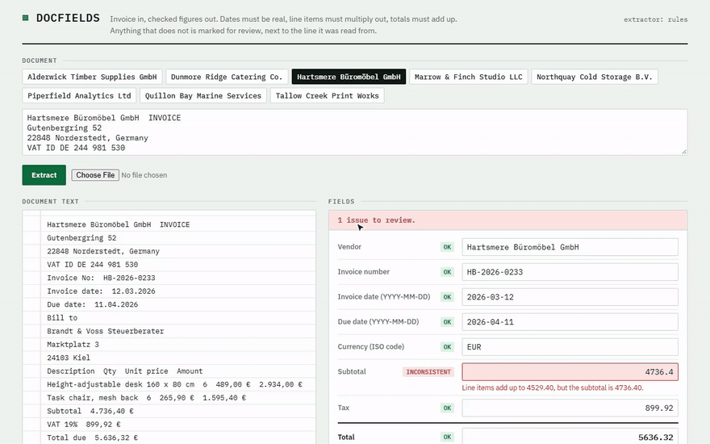

# Docfields

Invoice field extraction where the extracted numbers are checked by code before a person sees them, and a review screen shows every value next to the text it was read from.

**Live demo:** [docfields.btwstudio.dev](https://docfields.btwstudio.dev)



Upload an invoice PDF or paste its text. Docfields returns the vendor, invoice number, dates, currency, subtotal, tax, total and line items, each with a status (`ok`, `missing` or `inconsistent`), a reason in plain words, and the source snippet when one is available.

## Why validation is in code

Whatever reads the document, a rule-based parser or a language model, can be wrong in a way that looks fine: a dropped line item, a transposed digit, a total copied from the wrong row. Arithmetic does not depend on the extractor behaving, so the checks live in `src/validate.ts` and run on the output of every extractor:

- the object has the expected shape; dates are real calendar dates (`2026-02-30` fails); the currency is a 3-letter code
- each line item: `quantity x unit price = amount`, within 0.01
- the line items add up to the subtotal, within 0.01
- `subtotal + tax = total`, within 0.01
- the due date is not before the invoice date
- a source snippet is kept only if it really occurs in the document text

A model that claims `total: 25` for an invoice whose parts add up to 24 gets the total marked `inconsistent`, with the numbers in the reason. This is covered by a test with a stubbed model endpoint.

What validation cannot catch: a wrong value that is still self-consistent (a wrong vendor name, a mis-read description, a wrong invoice number). The review screen exists for those.

## Run it

```bash
npm install
npm run dev        # http://localhost:3470
```

No API key is needed. By default the `rules` extractor runs: deterministic regular expressions and heuristics over the document text. To use a model instead, point it at any OpenAI-compatible chat completions endpoint:

```bash
LLM_API_KEY=...  LLM_MODEL=...  LLM_BASE_URL=https://openrouter.ai/api/v1  npm run dev
```

`LLM_BASE_URL` is optional and defaults to OpenRouter. The model path is covered by tests with a stubbed `fetch` (valid JSON, fenced JSON, malformed JSON, wrong shape, inconsistent totals, fabricated source snippets). It has not been run against a live provider in this repository.

### API

| Route | Purpose |
|---|---|
| `POST /api/extract` | multipart field `file` (PDF, up to 2 MB) or JSON `{"text": "..."}`. Returns the text, the validated fields and line items, the mode and the time taken. Bad input gets `422` with a message. |
| `POST /api/validate` | re-validates an edited extraction (the review screen calls this on every edit) |
| `GET /api/samples`, `GET /api/samples/:id` | the bundled sample invoices and their extracted text |
| `GET /api/eval` | the last eval report |
| `GET /api/health` | `{ ok, mode }` |

`/api/extract` is limited to 20 requests per minute per IP.

### Review screen

Left: the document text. Right: an editable form. Focusing a field highlights its source snippet on the left. Editing a value re-runs validation on the server, so fixing a total turns its chip from `inconsistent` to `ok`. "Export JSON" shows the final JSON in a block with a copy button; nothing is downloaded.

## Evaluation

```bash
npm run eval
```

Runs the 8 PDFs in `samples/` through PDF text extraction and the active extractor, compares against `evals/expected.json`, prints a per-field table and every miss, and writes `evals/last-report.json` (also shown on the web page). It exits non-zero if field accuracy or line item accuracy falls below 0.85, if a flawed document is not flagged, or if a clean document is flagged.

The samples are fictional invoices generated by `scripts/make-samples.ts` with pdfkit: 3 layouts (a classic table, a modern layout with labels above values, a quantity-first statement), EUR and USD, European and US number formats, and 4 date styles. Two are deliberately flawed: one whose printed line items do not add up to its subtotal, one with no invoice number.

Result in `rules` mode, measured on 2026-11-15:

| Field | Correct |
|---|---|
| vendor | 8/8 |
| invoiceNumber | 8/8 |
| invoiceDate | 8/8 |
| dueDate | 8/8 |
| currency | 8/8 |
| subtotal | 8/8 |
| tax | 8/8 |
| total | 8/8 |
| all fields | 64/64 (100%) |

Line items extracted exactly: 24/24, no extra rows. Flawed documents flagged: 2/2 (the first on `subtotal`, the second on `invoiceNumber`). Clean documents flagged by mistake: 0/6. There are no misses to list on this set.

Read that 100% with care. The sample invoices and the rules were written by the same person, so the rules fit these layouts by construction. This is a regression check and a demonstration of the pipeline, not a measure of how the extractor does on invoices from the wild. Nothing in the extractor refers to a sample file name or an expected value.

The LLM mode has not been evaluated here; the same command runs it when `LLM_API_KEY` is set.

## Limits

Found by running the rules extractor on small texts outside the sample set:

- Amounts need two decimals. `1200` or `$1,200` is not read as money, so a table with whole-number prices yields no line items and no totals (the validator then reports them as missing).
- A line item description that wraps onto a second line is cut: only the last line is kept as the description. The arithmetic still passes, so validation does not flag it.
- `03/15/2026` style dates are read month-first unless the first number is above 12, so `04/05/2026` is ambiguous and is read as April 5.
- Only English month names, English labels (`Invoice No`, `Due date`, `Subtotal`, `VAT`), and the currencies `€ $ £` plus a short list of ISO codes. `$` is always read as USD.
- Only the first tax line is read, so invoices with several tax rates get one of them.
- PDFs need a text layer. Scanned documents are rejected with a message; there is no OCR.
- The reading order of a PDF is rebuilt from text positions. Unusual layouts (multi-column pages, rotated text) can scramble it.
- The vendor is the first plausible text near the top or under a `From` label. A logo-only header or a vendor named only in the footer will be missed or wrong.
- One invoice per document. Multi-page invoices are joined, and nothing is done about repeated headers.

## How it is built

```
src/
  types.ts             field names, Extraction shape, the Extractor port
  ingest.ts            PDF -> text (unpdf), lines rebuilt from text positions
  extract/
    rules.ts           deterministic extractor, no API key
    llm.ts             OpenAI-compatible extractor, injectable fetch
  validate.ts          shape check, field checks, arithmetic checks, statuses
  pipeline.ts          extract -> verify snippets -> validate; picks the extractor
  app.ts               Express routes, upload handling, per-IP rate limit
  server.ts            entry point, port 3470
  eval.ts              eval runner
  docfields.test.ts    Vitest suite
public/index.html      review screen, no framework
samples/               8 fictional invoices as PDF
scripts/make-samples.ts  generates samples/ and evals/expected.json (pdfkit)
evals/                 expected.json (ground truth), last-report.json
```

- The extractor sits behind one interface, so a different model, a different provider or a hand-written parser for one supplier can replace `rules` without touching validation or the UI.
- `npm run verify` runs the typecheck, the tests and the eval. `npm run samples` regenerates the PDFs and `expected.json`.
- PDF text comes from [`unpdf`](https://github.com/unjs/unpdf), which runs on Node 22 with no native build.

## Deploy

```bash
docker build -t docfields .
docker run -p 3470:3470 docfields
```

The image was built and smoke-tested locally: `/api/health` and a PDF upload to `/api/extract` both respond from the container.

## License

MIT
